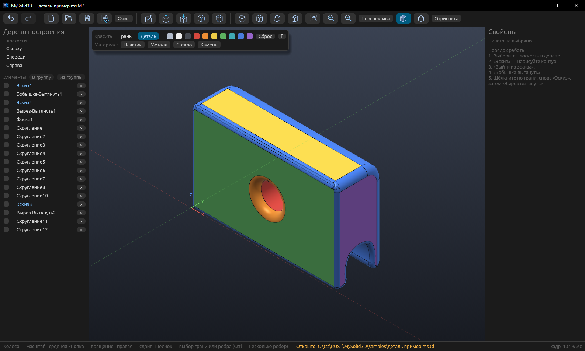
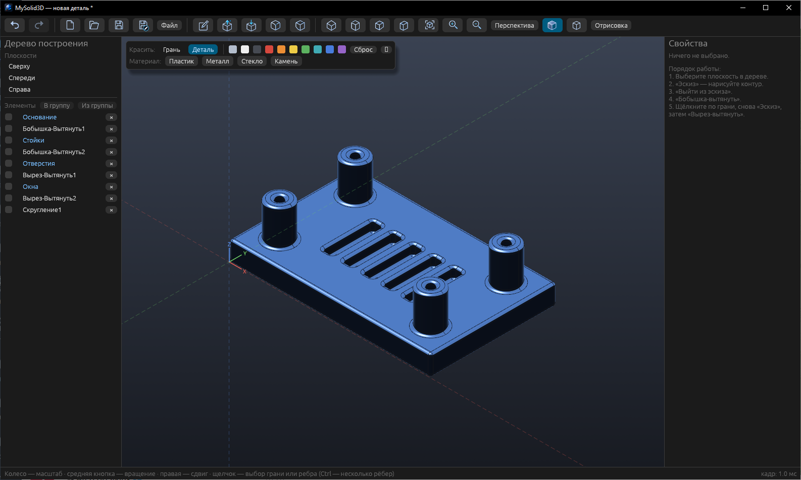
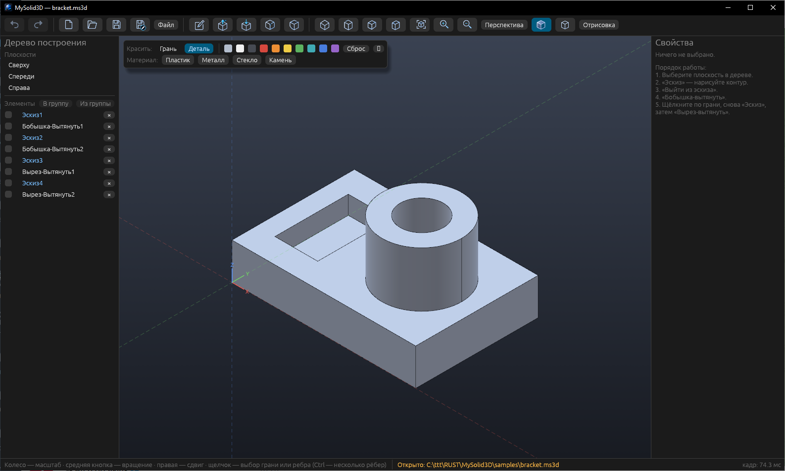

# MySolid3D

Параметрический 3D-редактор для моделирования деталей под печать на 3D-принтере.
Работа устроена как в SolidWorks: эскиз → бобышка/вырез → скругления и фаски, с деревом построения,
которое пересчитывается при изменении любого размера. Готовую деталь можно выгрузить в STL или STEP.

Написан на Rust. Геометрическое ядро — [OpenCascade](https://dev.opencascade.org/) (B-rep, булевы операции),
интерфейс — [egui](https://github.com/emilk/egui) поверх OpenGL, поэтому программа работает и на старых видеокартах.



| Построено через API: стойки, отверстия, окна, скругления, материал «металл» | Кронштейн: бобышки и вырезы |
|---|---|
|  |  |

## Возможности

**Эскиз**
- Линии, дуги, прямоугольники, окружности; линии построения (штриховые, в тело не входят).
- Размеры как в SolidWorks: выносные линии, стрелки, перетаскивание за подпись, ввод в мм с точностью 0,1.
- Взаимосвязи: совпадение, параллельность, перпендикулярность, коллинеарность, середина отрезка, горизонталь, вертикаль.
- Привязка к объектам текущего и более ранних эскизов, к рёбрам и вершинам тела.
- Операции: поворот, масштаб, зеркало, копия, смещение, скругление и фаска углов, массивы сеткой и по кругу.
- Импорт контуров из SVG (path с кривыми и дугами, rect, circle, ellipse, line, polyline, polygon, transform).
- Картинка-подложка (PNG, JPEG): её можно сдвигать и масштабировать мышью, она видна и на 3D-виде.

**Тело**
- Бобышка и вырез вытягиванием с выбором областей эскиза.
- Скругления и фаски рёбер; они переживают изменение размеров (рёбра находятся заново).
- Эскиз на плоской грани готового тела.
- Пошаговое построение, ошибки элементов подсвечиваются красным.

**Вид и оформление**
- Режимы: тело с рёбрами и без, скрытые линии, каркас, прозрачное тело.
- Перспектива с настраиваемым углом обзора, стандартные виды (сверху, спереди, справа, изометрия).
- Цвета и материалы граней и детали: пластик, металл, стекло, камень.
- Длина ребра при наведении, сумма длин выбранных рёбер.

**Работа с файлами**
- Собственный формат `.ms3d` (JSON), экспорт в STL и STEP.
- Отмена и повтор (Ctrl+Z / Ctrl+Y), дерево построения с группами, последние файлы.

**API для нейросетей и скриптов**
- Локальный HTTP-сервер (`--api` или галочка в меню «Файл»): JSON-команды строят деталь прямо в окне,
  человек видит каждый шаг и может отменить его через Ctrl+Z.
- Python-клиент `tools/mysolid_client.py` и MCP-сервер `tools/mcp_server.py` для Claude и других MCP-клиентов.
- Подробности — в [docs/API.md](docs/API.md).

## Установка

Готовая сборка для Windows x64 — на странице [Releases](../../releases): скачайте `mysolid3d.exe` и запустите.
Установка не нужна.

## Сборка из исходников

Нужно:
- [Rust](https://rustup.rs/) (stable, тулчейн `x86_64-pc-windows-msvc`);
- Visual Studio Build Tools с компонентом «Разработка классических приложений на C++» (компилятор MSVC и CMake).

```bat
set CMAKE_POLICY_VERSION_MINIMUM=3.5
cargo build --release
```

Переменная `CMAKE_POLICY_VERSION_MINIMUM` нужна для CMake 4: без неё он не читает старые `CMakeLists` ядра OpenCascade.
Первая сборка долгая (ядро OpenCascade собирается из исходников), дальше пересобирается только свой код.
Готовый файл — `target\release\mysolid3d.exe`. Для запуска можно использовать `run.cmd`.

В `vendor/` лежат исправленные копии крейтов `opencascade` и `opencascade-sys`: сборка привязок под MSVC
и безопасные скругление и фаска (`try_fillet_edges` / `try_chamfer_edges`).

## Структура

| Путь | Что там |
|------|---------|
| `src/model.rs` | Модель детали: эскизы, элементы, построение тела через OpenCascade |
| `src/app.rs` | Интерфейс: панели, инструменты эскиза, дерево построения |
| `src/render.rs`, `src/camera.rs` | Отрисовка OpenGL и камера |
| `src/svg.rs` | Импорт SVG в эскиз |
| `src/server.rs`, `src/app/api.rs` | HTTP API |
| `tools/` | Python-клиент, MCP-сервер, генератор иконок, пример скрипта построения |
| `samples/` | Примеры деталей |
| `docs/API.md` | Описание API |

## Лицензия

Код MySolid3D распространяется по лицензии [MIT](LICENSE).

Сторонние компоненты сохраняют свои лицензии: ядро OpenCascade и крейты `opencascade` / `opencascade-sys`
(исправленные копии в `vendor/`) распространяются по LGPL-2.1.
